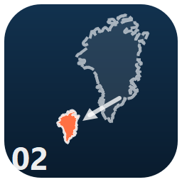
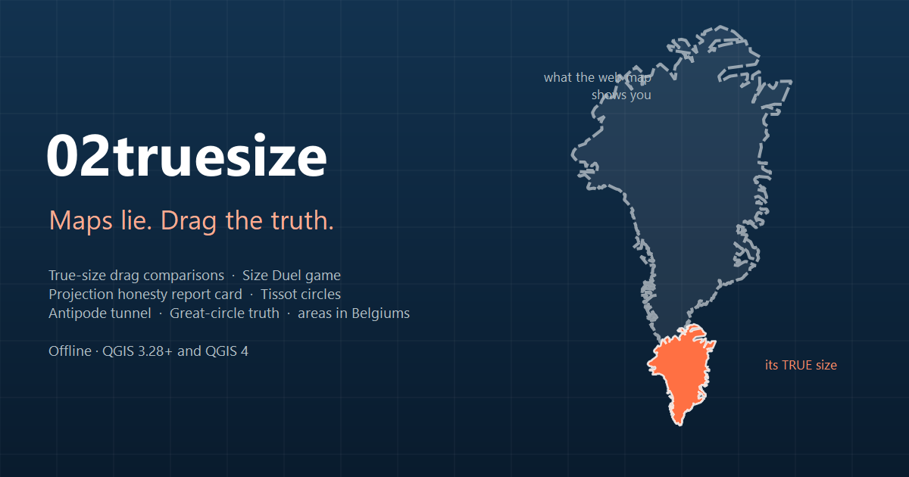

# 02truesize — Map Truth Lab

**Drag countries anywhere to compare their true size, grade your projection's honesty, play a Mercator-lie guessing duel, find antipodes, draw great circles and measure in playful units.**

---

## Why 02truesize?

**Every flat map lies — this plugin shows you how, playfully.** The everyday web map (Mercator) inflates whatever sits far from the equator: Greenland is drawn like a continent, yet Africa is about 14 times larger. 02truesize brings the much-loved [thetruesize.com](https://thetruesize.com) idea natively into QGIS and goes further: a drag-anywhere true-size comparator, a guessing game, a projection report card, Tissot circles, antipodes, great circles and measurements in Belgiums. Built for teaching projections, scale and spatial reasoning — and for having fun with the map you stare at every day.

## ✨ Features

- **True Size drag** — grab any country (bundled offline world layer) *or any polygon from your own layers* and drag it across the map; the outline is re-projected on the fly through an equal-area azimuthal projection centred under your cursor, so it **always covers its true ground area**. Rotate with `R`/`E`, drop as many coloured ghosts as you like, export them as a layer.
- **Administrative boundary vectors** — choose a country and download its ADM0
  country boundary from the bundled world data or ADM1 first-level units from
  Natural Earth's official 10m states/provinces archive.
- **Size Duel** — a built-in game: two countries drawn exactly the way a web-Mercator map draws them; guess which is *really* bigger. Score, streaks, and a per-round confession of how much the projection lied.
- **Projection honesty report card** — one click grades the **current project CRS**: separate marks for area and shape honesty (A+ to F), per-latitude inflation figures and a plain-language verdict.
- **Tissot indicatrix circles** — generate the classic distortion diagnostic as a styled memory layer (radius and spacing configurable): equal circles on the ground, telling shapes on the map.
- **Live distortion HUD** — a small readout pinned to the canvas showing how stretched areas and shapes are right where you are looking, updating as you pan.
- **Antipode tunnel** — click anywhere to learn where you would surface if you dug straight through the Earth, with a land-or-ocean verdict (it is almost always ocean) and a fly-to button.
- **Great-circle truth** — the genuinely shortest path between two clicks drawn against the map's straight line, with the wasted kilometres spelled out.
- **Fun units** — accurate geodesic measurements first, then the fun: areas in football pitches, Central Parks and **Belgiums**; distances in marathons, Bosphorus bridges and fractions of the way to the Moon.
- **Offline-first, dependency-free** — the generalized [Natural Earth](https://www.naturalearthdata.com)
  country workflow, geodesy and map tools work fully offline. Optional local
  ADM1 vectors use Natural Earth's official public-domain archive; no external
  QGIS or Python dependency is required.

## 🚀 Installation

**From the QGIS Plugin Hub (recommended):** `Plugins → Manage and Install Plugins…` → search for **"02truesize"** → *Install*.

**From a release zip:** download the latest zip from [Releases](https://github.com/YusufEminoglu/zero2truesize/releases) → `Plugins → Install from ZIP`.

Requires QGIS 3.28 or newer (QGIS 4 ready). No external Python dependencies.

## 📖 Quick start

1. Click the **02truesize** toolbar icon to open the dock.
2. On the **True Size** tab, tick **Show the built-in world layer**, press **Pick up & drag**, then click Greenland.
3. Move the cursor towards the equator and watch Greenland deflate; click to drop the ghost. Press `R`/`E` while carrying to rotate; right-click cancels.
4. Open the **Size Duel** tab and see how many rounds of "which is really bigger?" you survive.
5. On the **Distortion** tab, press **Grade my current projection** — then switch the project CRS (e.g. EPSG:3857 vs Mollweide) and grade it again.

For online administrative data, choose a country and either **ADM0** or **ADM1**,
then press **Download selected administrative boundaries**. The source switches
to the downloaded layer automatically. Data stays in memory unless you save it
with QGIS **Export > Save Features As**.

Natural Earth's 14.2 MB ADM1 archive is downloaded once per open panel and
reused for later country selections. A few tiny countries and territories do
not have ADM1 coverage; the panel then suggests ADM0.

## ⚙️ Reference

| Tab | Tool | What it does |
|-----|------|--------------|
| True Size | Pick up & drag | Equal-area re-centred ghost outlines of countries, active-layer polygons or downloaded administrative units; rotation, multi-ghost, export to layer |
| True Size | Download boundaries | Offline bundled ADM0 or country-filtered Natural Earth 10m ADM1 vectors |
| Size Duel | — | Mercator-drawn silhouettes, guess the truly bigger one; score, streak and best-streak memory |
| Truth Tools | Antipode tunnel | Click → antipode marker, country-or-ocean verdict, fly-to |
| Truth Tools | Great circle vs map line | Geodesic path vs straight map line with both ground lengths and the difference |
| Truth Tools | Fun units | Distance paths and clicked polygon areas in accurate-but-playful units |
| Distortion | Report card | Area & shape honesty grades plus verdict for the current project CRS |
| Distortion | Tissot circles | Constant ground-radius circle layer (250/500/1000 km, 15/30/45° spacing) |
| Distortion | Live HUD | On-canvas areal inflation & angular deformation readout at the view centre |

## 🧩 Part of the PlanX ecosystem

02truesize is one of 17 open-source QGIS plugins by the same author:

| Planning & analysis | CAD & production | 3D & visualization |
|---|---|---|
| [PlanX](https://github.com/YusufEminoglu/PlanX) — spatial-planning suite | [PlanX CAD Toolset](https://github.com/YusufEminoglu/PlanX-CAD) — drafting-grade CAD | [PlanX 3D City](https://github.com/YusufEminoglu/planx_3d_city) — Three.js city viewer |
| [GeoStats Lab](https://github.com/YusufEminoglu/planx_geostats) — spatial statistics | [EasyFillet](https://github.com/YusufEminoglu/EasyFillet) — tangent-arc fillet | [3D OSM Model](https://github.com/YusufEminoglu/osm_3d_model) — OSM → 3D city in browser |
| [Suitability Lab](https://github.com/YusufEminoglu/planx_suitability_lab) — raster MCDA | [Settlement Toolset](https://github.com/YusufEminoglu/PlanX-Settlement) — 9-stage settlement plans | [OSM Quick 3D](https://github.com/YusufEminoglu/osm_quick_3d) — OSM → native QGIS 3D |
| [DataCube Lab](https://github.com/YusufEminoglu/planx_datacube) — spatiotemporal cubes | [UIP Toolset](https://github.com/YusufEminoglu/PlanX-UIP) — Turkish master-plan automation | [Urban Procedural 3D](https://github.com/YusufEminoglu/planx_urban_procedural_3d) — parametric zoning lab |
| [Urban Resilience](https://github.com/YusufEminoglu/planx_urban_resilience) — 28 resilience tools | [ParcelFlux](https://github.com/YusufEminoglu/parcelflux) — parcel subdivision | [CartoLab](https://github.com/YusufEminoglu/planx_cartolab) — publication cartography |

## 📜 License & author

GPL-3.0 © [Yusuf Eminoğlu](https://github.com/YusufEminoglu) — bug reports and feature requests welcome in [Issues](https://github.com/YusufEminoglu/zero2truesize/issues).

World outlines derived from QGIS's bundled Natural Earth data (public domain). Inspired by [thetruesize.com](https://thetruesize.com).
ADM1 vectors come from [Natural Earth Admin 1 — States, Provinces](https://www.naturalearthdata.com/downloads/10m-cultural-vectors/10m-admin-1-states-provinces/)
version 5.1.1 (public domain).
